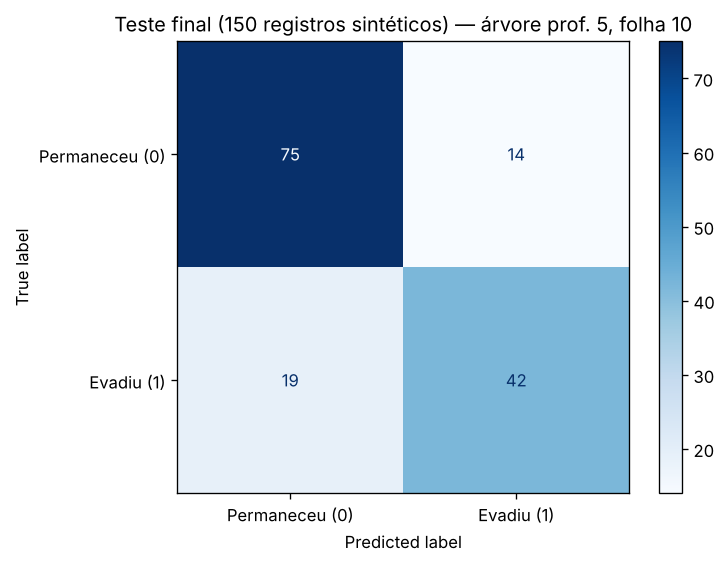
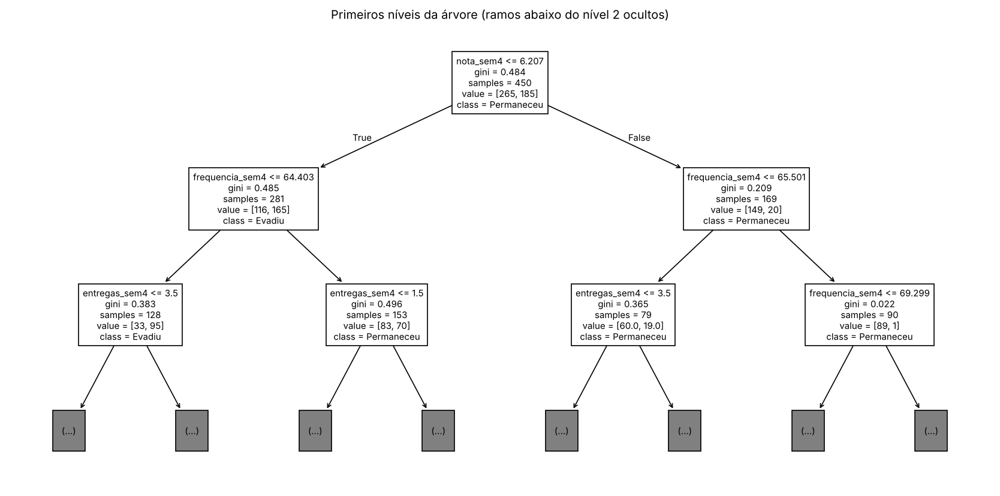
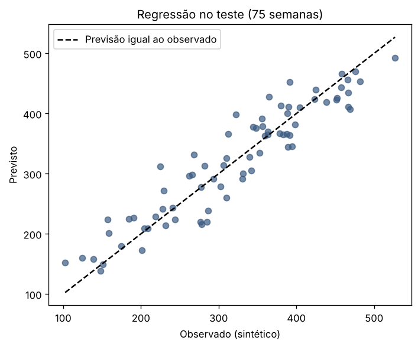
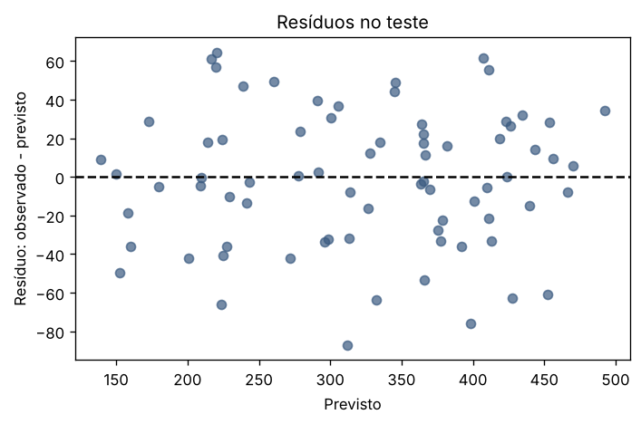

**Profa. Kadidja Valéria | UDF**  
Ciência de Dados e Aprendizado de Máquina · Sistemas de Informação · 2026.2

# Aula 2 — Registro do laboratório supervisionado

## Identificação

- Estudante ou equipe: **Arthur Rodrigues de Souza Vieira**
- Turma: **Sistemas de Informação — UDF**
- Data de realização: **16/10/2026**
- Integrantes e contribuições (se em equipe): **Trabalho individual: execução do notebook, exercícios, experimentos e relatório feitos por mim.**

## Percurso escolhido

- [x] Python/Colab ou Jupyter.
- [ ] Orange Data Mining.

Use o [notebook de apoio](notebooks/laboratorio.ipynb) ou o [CSV sintético](dados/educacionais-sinteticos.csv). O CSV contém 600 registros fictícios. Atributos: `frequencia_sem4`, `nota_sem4`, `entregas_sem4`. Alvo: `evasao_fim_semestre` (0 permaneceu, 1 evadiu). As associações foram definidas pela simulação, sem validade empírica sobre estudantes reais.

## 1. Ambiente e reprodução

| Item | Registro |
| --- | --- |
| Ambiente e data | Jupyter executado por `jupyter nbconvert --execute` em Linux, 16/10/2026; o mesmo notebook abre no Colab pelo botão do README. |
| Versões das ferramentas/bibliotecas | Python 3.13.18; NumPy 2.5.3; pandas 3.0.5; matplotlib 3.11.2; scikit-learn 1.9.1 (impressas na primeira célula). |
| Semente aleatória | 42 (`SEMENTE`), usada na simulação, na divisão, na validação cruzada e na árvore. |
| Caminho do notebook executado ou fluxo Orange | [notebooks/laboratorio-equipe.ipynb](notebooks/laboratorio-equipe.ipynb); números gravados em [notebooks/resultados_execucao.json](notebooks/resultados_execucao.json). |
| Origem dos dados e condição sintética | Simulação do notebook da professora; o notebook confere que o resultado é idêntico ao [CSV](dados/educacionais-sinteticos.csv) (`csv_igual_simulacao: true`). 100% sintéticos. |

## 2. Problema e preparação

- Pergunta de negócio: **Ao fim da semana 4, quais estudantes fictícios a equipe de apoio deveria procurar primeiro com um convite voluntário?**
- Unidade de análise e horizonte: **Um estudante fictício em um semestre; atributos observados até a semana 4, desfecho conhecido só no fim do semestre.**
- Atributos disponíveis no instante da previsão: **`frequencia_sem4` (% de presença, 35 a 100), `nota_sem4` (0 a 10), `entregas_sem4` (0 a 8 atividades).**
- Variável-alvo e sua natureza: **`evasao_fim_semestre`, binária: 59,0% permaneceram (0) e 41,0% evadiram (1). A estratificação manteve 41,1% no treino e 40,7% no teste.**
- Ausências e outros problemas encontrados: **30 notas ausentes (5%), sorteadas ao acaso pela simulação; nenhum identificador; o alvo é sorteado a partir de uma probabilidade, então há ruído irredutível.**
- Tratamentos e conjunto usado para aprendê-los: **`SimpleImputer(strategy='median')` como primeira etapa do `Pipeline`, ajustado só no treino (e, na validação cruzada, só na parte de treino de cada dobra). A mediana aprendida foi 5,146. Sem padronização, porque a árvore não precisa.**

## 3. Desenvolvimento e teste

- Método de divisão e justificativa: **`train_test_split` com 25% de teste, `stratify=y` e semente 42. Os registros simulados são independentes, então a divisão aleatória é adequada; em turmas reais eu reservaria semestres posteriores.**
- Quantidades de treino e teste: **450 e 150 registros.**
- Procedimento de validação no treino: **`StratifiedKFold` com 5 partes, embaralhado, semente 42, sobre os 450 registros do treino; registrei médias e desvios de validação e a acurácia de treino de cada dobra.**
- Parâmetros da árvore e como foram escolhidos: **Roteiro da professora: `max_depth` ∈ {2, 3, 5, None} com `min_samples_leaf=10`; regra fixada antes de rodar: maior acurácia média de validação. Resultado: profundidade 2 → 0,6844 ± 0,0425; 3 → 0,7022 ± 0,0257; 5 → 0,7222 ± 0,0391; None → 0,7111 ± 0,0477. Escolhida `max_depth=5`. A grade do exercício 1 (folhas 5, 20 e 40) foi rodada depois dessa escolha e antes do teste, e não mudou o modelo (seção 5).**
- Como o teste ficou fora da seleção: **O teste só entrou na célula de avaliação final, uma vez, depois da escolha e do ajuste no treino completo. Os experimentos (a), (b) e (c) da seção 5 foram feitos depois de abrir o teste e são declarados como diagnóstico, sem troca de modelo.**

### Alternativa Orange

Confira o alvo como categórico. Registre as conexões: File/Select Columns → Test & Score (Data), Tree → Test & Score (Learner), Test & Score → Confusion Matrix (Evaluation Results). Data Table permite inspeção. Se usar Preprocess, conecte o preprocessor ao learner para ajustar transformações dentro do treino. Não use apenas `Test on train data` como avaliação final.

**Fluxo e método de avaliação realmente utilizados:** Não se aplica: percurso Python/Jupyter, com holdout estratificado 75/25 e validação cruzada estratificada de 5 partes no treino.

Se comparar configurações, use validação no treino e reserve teste independente. Documente em Test & Score as entradas Data e Test Data, quando utilizadas.

## 4. Resultados calculados de classificação

| Modelo | Configuração | Acurácia de treino | Acurácia de validação e dispersão | Acurácia de teste |
| --- | --- | --- | --- | --- |
| Referência | `DummyClassifier(strategy='most_frequent')`: sempre "permaneceu" | 0,5889 | 0,5889 ± 0,0000 | 0,5933 (sensibilidade 0) |
| Árvore final | mediana no `Pipeline` + `DecisionTreeClassifier(max_depth=5, min_samples_leaf=10, random_state=42)`; 21 folhas | 0,8133 no treino completo (0,8111 média nas dobras) | 0,7222 ± 0,0391 | **0,7800** |

**Matriz: linhas reais e colunas previstas; classe positiva = 1.** ([imagem](assets/matriz-confusao.png))

| Real / previsto | Permaneceu (0) | Evadiu (1) |
| --- | --- | --- |
| Permaneceu (0) | 75 (TN) | 14 (FP) |
| Evadiu (1) | 19 (FN) | 42 (TP) |

- Acurácia calculada manualmente pela matriz: **(75 + 42) / 150 = 117 / 150 = 0,78, igual à da biblioteca.**
- Sensibilidade da classe 1: **42 / (42 + 19) = 42 / 61 = 0,689. Também calculei precisão 42 / 56 = 0,75, especificidade 75 / 89 = 0,843 e F1 0,718.**
- Comparação com referência: **+18,7 pontos de acurácia (0,78 contra 0,593). A diferença que importa, porém, está na sensibilidade: a referência não aponta nenhuma evasão (0 de 61), a árvore aponta 42. O teste ficou dentro da faixa da validação (0,722 ± 0,039), um pouco acima da média, o que é compatível com a variação entre dobras.**
- Consequências dos falsos positivos: **14 estudantes que permaneceriam entrariam na lista de convite: custo de tempo da equipe e algum constrangimento se o convite for mal formulado. Como a ação é voluntária e de apoio, é o erro mais barato.**
- Consequências dos falsos negativos: **19 estudantes que evadiram (31% dos 61) não seriam procurados. É o erro caro, porque anula o propósito; por isso o convite não pode depender só da lista, e o canal de apoio precisa ficar aberto a todos.**
- Interpretação do gráfico e da árvore: **A raiz pergunta `nota_sem4 ≤ 6,21`; nos dois ramos a próxima pergunta é a frequência (64,4% e 65,5%), o mesmo corte que apareceu na minha tabela exploratória por faixas de frequência (evasão de 54–56% abaixo de 65% contra 24% acima de 80%). Importâncias: nota 0,622, frequência 0,235, entregas 0,143. São associações criadas pela simulação, úteis para prever e nada mais ([árvore](assets/arvore.png)).**

## 5. Experimentos no treino

Compare parâmetros usando apenas treino/validação. Após conhecer o teste, uma nova seleção exige novo teste independente para avaliação final.

| Experimento | Alteração | Resultado de validação | Interpretação |
| --- | --- | --- | --- |
| 1 (exercício 1, antes do teste) | `min_samples_leaf` ∈ {5, 10, 20, 40} × `max_depth` ∈ {2, 3, 5, None} | Melhor média: folha 40 com profundidade 5 ou None, 0,7289 ± 0,0303; 11 das 16 combinações ficam a menos de um desvio dessa. Distância treino–validação: 0,154 (folha 5, None: 0,868 → 0,713) até 0,047 (folha 40). | As médias são indistinguíveis dentro da incerteza; o que a grade mostra com nitidez é o sobreajuste das folhas pequenas. Mantive o modelo do roteiro (0,7222 ± 0,0391) porque a regra de escolha foi fixada antes e o ganho de 0,007 é menor que o desvio. |
| 2 (exercício 4) | Retirar um atributo por vez (prof. 5, folha 10) | Todos: 0,7222 ± 0,0391. Sem frequência: 0,7156 ± 0,0362 (−0,007). Sem nota: 0,6289 ± 0,0475 (−0,093). Sem entregas: 0,7022 ± 0,0310 (−0,020). | Só a nota faz falta além do desvio; os outros dois se compensam parcialmente. Utilidade preditiva nesta simulação, não causa (ver pergunta 2 abaixo). |
| 3 (próprio, a) | Estratégia de imputação dentro do `Pipeline`: mediana, média, constante 0, mediana + indicador de ausência; e demonstração de vazamento (mediana calculada com os 600 registros antes da divisão) | Mediana = média = 0,7222 ± 0,0391; constante 0 = 0,7333 ± 0,0070; mediana + indicador = 0,7178 ± 0,0376. Vazamento: mediana do treino 5,146 contra 4,962 global; acurácia de teste idêntica (0,78) nas duas versões, com 7 notas ausentes no teste. | Para uma árvore, mediana e média caem do mesmo lado dos limites, então nada muda. O indicador não ajuda porque a ausência foi sorteada sem relação com o alvo. A constante 0 ganhou por coincidência (empurra ausentes para o ramo de nota baixa), dentro do desvio. O vazamento não alterou o resultado aqui, mas continua errado como método: a preparação usou informação do teste. |
| 4 (próprio, b) | Poda por custo-complexidade: `ccp_alpha` ∈ {0; 0,002; 0,005; 0,01; 0,02; 0,04}, folha 10, sem limite de profundidade | Sem poda: 0,7111 ± 0,0477 (26 folhas). Alfa 0,005: 0,7267 ± 0,0480 (11 folhas). Alfa 0,02: 0,7022 (3 folhas). Alfa 0,04: 0,6933 (2 folhas). | A poda chega ao mesmo patamar da escolha por profundidade com metade das folhas (11 contra 21), sem vantagem estatística. Feito depois do teste, então só diagnóstico. |
| 5 (próprio, c) | Quantas regras um sistema precisaria: árvores de 1, 2 e 3 níveis (2, 4 e 8 folhas) contra a escolhida (21 folhas) | 1 nível: 0,6933 ± 0,0229; 2 níveis: 0,6844 ± 0,0425; 3 níveis: 0,7022 ± 0,0257; 5 níveis: 0,7222 ± 0,0391. Regras de 2 níveis no treino: nota ≤ 6,2 e frequência ≤ 64,4% → 95 de 128 evadiram; nota > 6,2 e frequência > 65,5% → 1 de 90. | Quatro regras chegam a 0,04 da árvore completa. A folha "nota baixa, frequência boa" (70 evasões em 153) é onde a regra simples erra quase metade e onde a árvore completa usa as entregas. Conclusão para o sistema: usar o modelo, mas exibir as regras principais para a equipe entender a sinalização. |

Responda:

1. Como a profundidade e o tamanho das folhas podem afetar o sobreajuste? **Profundidade grande e folhas pequenas permitem que a árvore crie uma pergunta para cada punhado de registros, inclusive para o ruído: na grade, folha 5 sem limite de profundidade chega a 0,868 no treino e cai para 0,713 na validação (distância 0,154). Folhas de 40 reduzem a distância para 0,047 sem perder validação. No sentido oposto, profundidade 2 subajusta: 0,733 no treino e 0,684 na validação, abaixo de todas as outras. O ponto bom está no meio e só a validação, não o treino, mostra onde.**
2. Retirar um atributo e observar mudança no desempenho prova causalidade? **Não. A queda de 0,093 sem a nota mostra que a nota carrega informação que os outros dois atributos não substituem **nesta base**. Isso é diferente de dizer que nota baixa causa evasão: na simulação, nota e evasão foram ligadas por uma fórmula; na vida real, as duas podem ser efeito de uma causa comum (trabalho, saúde, transporte). Além disso, se dois atributos forem muito correlacionados, retirar um deles quase não muda nada, e isso não significa que ele seja irrelevante. Causalidade exigiria intervenção ou desenho específico.**
3. Se 95% permanecem, o que acontece com um modelo que sempre prevê permanência? **Calculei o cenário em código com 190 permanências e 10 evasões: acurácia 0,95, matriz [[190, 0], [10, 0]], sensibilidade 0. Ele acerta 95% sem apontar um único caso de evasão; todos os evadidos viram falsos negativos. A matriz revela a coluna "previsto 1" vazia. É a razão para comparar sempre com a referência e olhar a sensibilidade; no meu projeto, 70% das ocorrências simuladas ficam sem resposta, e a mesma armadilha aparece na [atividade 07](07-aplicacao-ocorrencias.md).**

## 6. Regressão — seção independente

Execute a seção da biblioteca no notebook ou registre o procedimento equivalente em Orange. Dados também sintéticos. Alvo numérico: empréstimos por semana.

| Item | Registro |
| --- | --- |
| Atributos e alvo | `usuarios_ativos` (100 a 1000) e `horas_abertura` (20 a 60 h); alvo `emprestimos_semana`, contínuo; 300 semanas sintéticas geradas por 30 + 0,35·usuários + 2,5·horas + ruído normal (desvio 35). |
| Divisão e preparação | Holdout 75/25 sem estratificação (225 e 75 semanas), semente 42; `SimpleImputer` (mediana) + `LinearRegression` no `Pipeline`. Coeficientes ajustados: 0,348 por usuário ativo, 2,297 por hora, intercepto 37,3 (os valores da simulação eram 0,35, 2,5 e 30). |
| MAE do modelo e unidade | 28,59 empréstimos por semana |
| MAE da referência | 84,73 empréstimos por semana (`DummyRegressor`, média do treino) |
| R² do teste | 0,8774 (a referência, avaliada no teste, dá −0,0037) |
| Interpretação do gráfico observado/previsto | Pontos ao longo da diagonal em toda a faixa, sem curvatura ou agrupamento; a dispersão em torno da linha é o ruído da simulação ([imagem](assets/regressao-observado-previsto.png)). |
| Interpretação dos resíduos | Média −1,28, desvio 35,5, entre −87 e +65; só 2 de 75 passam de 70 em módulo; correlação com o previsto 0,03. Nenhum padrão (funil ou curva), coerente com ruído constante ([imagem](assets/regressao-residuos.png)). Exercícios extras: os erros absolutos dos cinco primeiros registros vão de 0,39 a 42,29 (média 16,65); na validação cruzada do treino, o MAE vai de 28,9 (ambos) para 35,9 sem as horas e 83,7 sem os usuários (referência 87,2). |
| Limitação de extrapolação | Pedi previsões para 10.000 usuários (3.609 empréstimos) e para 168 horas semanais (597). Os números saem, mas o modelo só viu de 100 a 1000 usuários e de 20 a 60 horas; fora disso a linearidade é suposição. Um sistema deveria marcar entradas fora do domínio de treino. Também não há ordem temporal nem sazonalidade na simulação. |

Explique por que R² não é porcentagem de acertos: **R² = 1 − (soma dos erros quadráticos do modelo ÷ soma dos erros quadráticos de prever a média do conjunto avaliado). Ele diz quanto do erro quadrático da "média" o modelo eliminou: 0,877 significa que restou 12,3% desse erro, não que 87,7% das semanas foram acertadas. Em regressão nenhuma previsão é exatamente igual ao observado, então "acerto" nem é definido. R² pode ser negativo quando o modelo erra mais que a média, como aconteceu na regressão de dias até a resposta da [atividade 07](07-aplicacao-ocorrencias.md) (R² = −0,97).**

## 7. Evidências e conclusão

- Link relativo do notebook/fluxo: **[notebooks/laboratorio-equipe.ipynb](notebooks/laboratorio-equipe.ipynb)**
- Links das imagens, se houver: **[matriz-confusao.png](assets/matriz-confusao.png), [arvore.png](assets/arvore.png), [regressao-observado-previsto.png](assets/regressao-observado-previsto.png), [regressao-residuos.png](assets/regressao-residuos.png)**
- Principal aprendizado: **Decidir a regra de seleção antes de rodar os experimentos e deixar o teste para o fim mudou a minha maneira de ler os números: várias configurações "melhores" da grade estavam dentro do ruído. E o `Pipeline` resolve, por construção, um erro que eu cometeria no código de um sistema: preparar os dados com informação que ainda não existiria no momento da previsão.**
- Limitações de generalização e vieses possíveis: **Base sintética com associações escolhidas pela fórmula; um único teste de 150 registros (a acurácia 0,78 tem incerteza de alguns pontos); sem grupos reais para auditar equidade; sem divisão temporal. O ruído do alvo põe um teto no desempenho: nenhuma configuração passou de 0,73 na validação.**
- Cuidados com privacidade e uso responsável: **Sem identificadores no modelo; lista de sinalizados restrita à equipe de apoio, com trilha de acesso; descarte ao fim do semestre; convite sempre voluntário, revisado por uma pessoa, e sem efeito sobre avaliação ou matrícula.**

[Voltar ao início](README.md).
