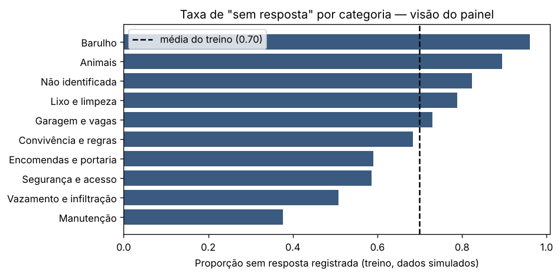
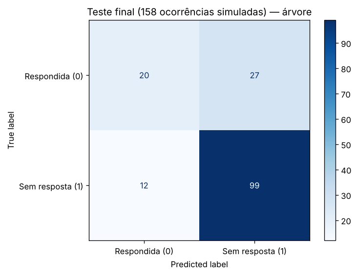
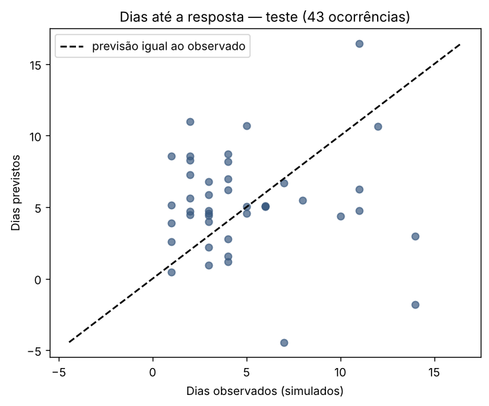

**Profa. Kadidja Valéria | UDF**  
Ciência de Dados e Aprendizado de Máquina · Sistemas de Informação · 2026.2

# Aplicação ao projeto — o que o painel deveria destacar como risco de ficar sem resposta

## Identificação

- Estudante ou equipe: **Arthur Rodrigues de Souza Vieira**
- Turma: **Sistemas de Informação — UDF**
- Data de realização: **16/10/2026**
- Integrantes e contribuições: **Formulação, notebook e análise desta atividade feitos individualmente por mim. O projeto em que ela se apoia é desenvolvido em dupla com Ramon Guilherme Marques do Nascimento, responsável pelos dados e pela análise exploratória; a minha parte no projeto é o sistema web, o painel de indicadores, a importação do histórico e o piloto com teste de usabilidade.**

## 1. O projeto e o meu recorte

O projeto da Unidade III ([documento de definição](../../Unidade_3_Gestão_de_Projetos_em_Ciencia_de_Dados/Template-Definicao-Projeto-Ciencia-de-Dados.md)) substitui o livro de ocorrências em papel de um condomínio residencial do DF por um sistema web com registro, status, histórico imutável, perfis (morador, portaria, síndico) e um painel de indicadores. O documento coloca IA e ML **fora do escopo**; a parte prática do projeto ([pasta `Projeto_DataScience`](../../Projeto_DataScience/)) segue o CRISP-DM sobre uma transcrição **simulada**, porque a transcrição do livro real, o questionário com moradores e o piloto ainda estão **pendentes** (dependem da autorização do síndico e da consulta ao CEP).

Meu recorte vem de uma decisão de tela que eu preciso tomar de qualquer jeito: a lista de ocorrências abertas do síndico vai ter um selo de "atenção". A pergunta é **o que acende esse selo**: uma regra fixa calculada a partir dos indicadores do painel ou um modelo treinado. A atividade usa o roteiro do laboratório da Aula 2 (holdout estratificado, imputação dentro do `Pipeline`, árvore de decisão contra `DummyClassifier`, validação cruzada só no treino; e `LinearRegression` contra `DummyRegressor`) para responder com números, ainda que simulados.

## 2. Problemas escolhidos

| Item | Classificação | Regressão |
| --- | --- | --- |
| Pergunta de negócio | No momento em que uma ocorrência é registrada, o painel consegue destacá-la como "risco de ficar sem resposta"? | Para as ocorrências que recebem resposta, dá para estimar em quantos dias ela vem, por ocorrência? |
| Decisão apoiada | Ordem da fila do síndico e critério do selo de atenção | Mostrar ao morador um prazo estimado ao registrar |
| Unidade de análise | Uma ocorrência | Uma ocorrência respondida |
| Atributos (conhecidos no registro) | `categoria` (consenso da dupla), `registrado_por`, `local`, `hora_num`, `noturno`, `fim_de_semana` | Os mesmos |
| Alvo | `sem_resposta` (1 = sem resposta registrada), conhecido semanas depois | `dias_ate_resposta`, conhecido na resposta |
| Tipo de tarefa | Classificação binária supervisionada | Regressão supervisionada |

`data_resposta` e `desfecho` ficam fora porque só existem depois do registro. Diferente do experimento do Ramon na disciplina (sugestão da categoria a partir do texto livre), aqui o texto não entra: uso só os campos estruturados que o formulário do sistema terá.

## 3. Dados

| Item | Registro |
| --- | --- |
| Origem | **Transcrição simulada** gerada pelo notebook CRISP-DM do projeto, com as colunas do dicionário de dados planejado e defeitos de livro escrito à mão. Cópia em [dados/livro_ocorrencias_transcrito.csv](dados/livro_ocorrencias_transcrito.csv); o notebook também procura o arquivo na pasta do projeto e no GitHub. **Nenhum registro real foi usado.** |
| Tamanho | 655 registros brutos, nov./2024 a out./2026. Preparação mínima no meu notebook: 16 duplicatas exatas, 4 resumos com número de apartamento e 4 datas fora do período removidos → **631 ocorrências**. A limpeza completa (V1–V7) é parte do notebook do Ramon; aqui repeti só o necessário. |
| Ausências | 50 registros sem hora (viram `NaN` em `hora_num` e `noturno`, imputados dentro do `Pipeline` pela mediana, com indicador de ausência); 30 sem local (categoria "Não informado"). |
| Alvo | 70,0% das ocorrências sem resposta registrada; a estratificação manteve 70,0% no treino e 70,3% no teste. |
| Categorias | Barulho 137; Manutenção 93; Garagem e vagas 87; Vazamento e infiltração 86; Convivência e regras 49; Animais 49; Lixo e limpeza 48; Segurança e acesso 36; Encomendas e portaria 24; Não identificada 22. |
| Por que não dados reais | A transcrição ainda não aconteceu. Quando acontecer, o CSV real entra no lugar e o notebook roda igual. |

## 4. Método

| Item | Registro |
| --- | --- |
| Ambiente | Jupyter (nbconvert), Python 3.13.18, scikit-learn 1.9.1, pandas 3.0.5, NumPy 2.5.3, matplotlib 3.11.2. Semente 42. |
| Notebook | [notebooks/ocorrencias-painel-sem-resposta.ipynb](notebooks/ocorrencias-painel-sem-resposta.ipynb) (executado; abre no Colab). Números em [notebooks/resultados_ocorrencias.json](notebooks/resultados_ocorrencias.json). |
| Divisão | Holdout estratificado 75/25: 473 para treino e 158 para teste. |
| Preparação | `ColumnTransformer` dentro do `Pipeline`: `OneHotEncoder(handle_unknown='ignore')` para categoria, quem registrou e local; `SimpleImputer(median, add_indicator=True)` para hora, noturno e fim de semana. Tudo aprendido só no treino (e só na parte de treino de cada dobra). |
| Modelo e seleção | `DecisionTreeClassifier`, grade `max_depth` ∈ {2, 3, 4, 5, None} × `min_samples_leaf` ∈ {5, 10, 20}, validação cruzada estratificada em 5 partes no treino; regra fixada antes: maior acurácia média, desempate pela configuração mais simples. Registrei também sensibilidade e acurácia balanceada. |
| Referências | `DummyClassifier(most_frequent)` (sempre "sem resposta") e uma **regra de painel sem modelo**: destacar se a taxa histórica de "sem resposta" da categoria, calculada só no treino (ou só na parte de treino da dobra), passa de 50%. |
| Conferência extra | O mesmo pipeline reaplicado na divisão temporal do notebook do projeto (treino até abr./2026, teste mai.–out./2026), sem reescolher nada. |
| Regressão | 170 ocorrências respondidas com data válida (7 com resposta antes do registro e 12 "sim" sem data ficaram fora); holdout 75/25 (127/43); `LinearRegression` com a mesma preparação; `DummyRegressor(mean)`; `KFold` de 5 partes no treino; e a "mediana da categoria no treino" como indicador de painel. |

## 5. Resultados calculados

**Visão do painel (treino, sem modelo):** taxa de "sem resposta" por categoria vai de 96% (Barulho, 101 casos) a 38% (Manutenção, 69); Animais 90%, Lixo e limpeza 79%, Garagem 73%, Vazamento 51%. Por quem registrou: morador 77%, portaria 70%, zeladoria 40% ([gráfico](assets/ocorrencias-taxa-categoria.png)).

**Validação cruzada (treino, 473 ocorrências):**

| Candidato | Acurácia de treino | Acurácia de validação ± desvio | Sensibilidade (classe 1) | Acurácia balanceada |
| --- | --- | --- | --- | --- |
| Referência (sempre sem resposta) | — | 0,6998 ± 0,0043 | 1,000 | 0,500 |
| Regra de painel: taxa da categoria > 50% | — | 0,7209 ± 0,0180 | 0,870 | 0,621 |
| Árvore só com a categoria (prof. 3, folha 20) | — | 0,7336 ± 0,0323 | 0,900 | 0,622 |
| **Árvore escolhida: `max_depth=3`, `min_samples_leaf=20`** | 0,7431 | **0,7315 ± 0,0392** | 0,904 | 0,617 |
| Árvore sem limite, folha 5 (pior da grade) | 0,8055 | 0,6723 ± 0,0350 | 0,771 | 0,607 |
| Árvore sem limite, folha 20 | 0,7532 | 0,7231 ± 0,0190 | 0,828 | 0,653 |

**Teste final (158 ocorrências, uma única vez):**

| Modelo | Acurácia | Sensibilidade | Precisão | Especificidade | Acurácia balanceada | Destacadas | TN | FP | FN | TP |
| --- | --- | --- | --- | --- | --- | --- | --- | --- | --- | --- |
| Referência | 0,7025 | 1,000 | 0,703 | 0,000 | 0,500 | 158 | 0 | 47 | 0 | 111 |
| Regra: taxa da categoria > 50% | 0,7405 | 0,919 | 0,761 | 0,319 | 0,619 | 134 | 15 | 32 | 9 | 102 |
| **Árvore escolhida** | **0,7532** | 0,892 | 0,786 | 0,426 | 0,659 | 126 | 20 | 27 | 12 | 99 |

Acurácia da árvore à mão: (20 + 99) / 158 = 0,7532. Treino 0,7526, validação 0,7315: sem sobreajuste (6 folhas). Falsos positivos por categoria: Vazamento 10, Garagem 7, Convivência 4; falsos negativos: 9 dos 12 são de Manutenção.

**Regras da árvore** ([figura](assets/ocorrencias-arvore.png)): raiz "é Barulho?" (65 de 65 ocorrências de barulho em dia de semana no treino ficaram sem resposta); depois "é Manutenção?" e "foi registrada pela zeladoria?". Importâncias: Barulho 0,489; Manutenção 0,302; Zeladoria 0,182; fim de semana 0,016; hora 0,010.

**Divisão temporal (mesmo pipeline, treino 482 até abr./2026, teste 149):** acurácia 0,698, **igual à referência (0,698)**; sensibilidade 0,885; precisão 0,736; F1 0,803; acurácia balanceada 0,576.

**Regressão (dias até a resposta):** mediana 4 dias, média 5,6, máximo 40 (170 casos). Teste (43): MAE da regressão linear **3,76 dias** contra **3,20** da referência (média do treino); **R² = −0,97**. Validação cruzada no treino: 4,65 ± 0,52 contra 3,57 ± 0,93 da referência. Mediana da categoria (painel, sem modelo): MAE **2,64** no teste ([gráfico](assets/ocorrencias-regressao-observado-previsto.png)).

## 6. Interpretação

- **Resultado calculado:** a árvore vence a referência em acurácia (0,753 contra 0,703) e, sobretudo, em especificidade (0,43 contra 0): ela deixa de destacar 20 ocorrências que seriam respondidas de qualquer jeito. Mas destaca 126 das 158 (80%) e fica a 1,3 ponto da regra de painel (0,741), que não precisa de modelo. Na divisão temporal, a árvore empata com a referência em acurácia.
- **Interpretação:** quase toda a informação está na categoria e em quem registrou; hora e dia quase não entram. Um selo que acende em 80% das ocorrências não ajuda o síndico a priorizar. O que ajuda é o inverso: dizer quais ocorrências **costumam** ser respondidas (Manutenção, registros da zeladoria) e tratar o restante como fila por antiguidade. Os 9 falsos negativos de Manutenção mostram o custo de um selo baseado em categoria: a categoria mais respondida também tem casos esquecidos, e são justamente esses que um painel deveria pegar com outra regra, "aberta há mais de X dias", que não depende de previsão.
- **Regressão:** com 127 registros de treino e cerca de 30 colunas após o one-hot, a regressão linear ajusta ruído e perde para a média; o alvo é assimétrico (poucos casos de 20 a 40 dias) e a mediana por categoria é o melhor indicador dos três. Não vou mostrar "prazo previsto" por ocorrência; vou mostrar "mediana histórica da categoria: 4 dias (n = 63)".
- **Hipótese:** com o livro real, a taxa de resposta e a distribuição por categoria devem ser outras, e o desbalanceamento pode ser ainda maior; se a hipótese H2 do projeto (maioria sem resposta) se confirmar, a referência "sempre sem resposta" continuará difícil de bater em acurácia. Só a transcrição real, com divisão temporal, responde.
- **Decisão para o sistema:** o selo de atenção será calculado por regras transparentes a partir dos indicadores que o painel já calcula (taxa histórica da categoria e dias em aberto), sem modelo, coerente com o escopo da Definição. O pipeline deste notebook fica guardado para ser reavaliado com os dados reais e os registros do piloto.

## 7. Limites, privacidade e próximos passos

- **Dados simulados não validam nada sobre o condomínio:** as taxas por categoria foram parâmetros da simulação; o experimento valida o procedimento e a comparação com a regra, não o resultado.
- **O alvo é incerto por construção:** "sem resposta no livro" pode ser "resolvido e não anotado". No sistema, isso melhora porque o status é obrigatório; mas o histórico importado carrega a incerteza, e qualquer comparação antes × depois precisa dizer isso.
- **Privacidade:** o modelo usa só campos estruturados e anonimizados (sem texto livre, sem unidade); mesmo assim, o painel agrupa categorias com menos de 3 casos por bloco, como já previsto na Definição, e o selo não deve expor quem registrou.
- **Uso responsável:** o destaque orienta a fila do síndico; não gera advertência, não muda prazo contratual nem prioriza um morador em detrimento de outro. As ocorrências não destacadas continuam visíveis e respondíveis.
- **Vieses:** registros feitos pela portaria em nome de moradores sem celular podem ter padrão diferente; antes de qualquer uso, comparar o erro por `registrado_por`, que o CSV já tem.
- **Próximos passos:** (1) importar a transcrição real e reexecutar com divisão temporal; (2) no piloto, registrar o status e medir a taxa de resposta antes × depois (H5); (3) só então decidir se um modelo entra no painel, comparando-o de novo com a regra de categoria.
- **Outras ideias de ML para o sistema** estão na [atividade 01, seção 5](01-aula1-conceitos.md): aviso de registro repetido, previsão de volume semanal para a escala da portaria e alerta de semana atípica.

## Fontes

- VIEIRA, Arthur Rodrigues de Souza; NASCIMENTO, Ramon Guilherme Marques do. *Livro de ocorrências digital para condomínios residenciais: do registro em papel a indicadores para a gestão do síndico* — definição do projeto de Ciência de Dados. UDF, Brasília, 2026. [Documento](../../Unidade_3_Gestão_de_Projetos_em_Ciencia_de_Dados/Template-Definicao-Projeto-Ciencia-de-Dados.md); parte prática CRISP-DM em [`Projeto_DataScience`](../../Projeto_DataScience/).
- SCIKIT-LEARN. *User Guide* (Pipeline, ColumnTransformer, OneHotEncoder, SimpleImputer, DecisionTreeClassifier, LinearRegression, cross_validate). https://scikit-learn.org/stable/user_guide.html. Acesso em: 16 out. 2026.
- Ferramentas utilizadas: Python, Jupyter/Colab, scikit-learn, pandas, NumPy e matplotlib. Os números foram conferidos executando o notebook do início ao fim.

[Voltar ao início](README.md).
